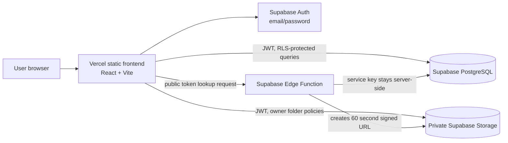

# CloudVault

CloudVault is a responsive cloud file-storage and sharing mini-project built with React, TypeScript, Vite, Supabase Auth, PostgreSQL, private Supabase Storage, and an Edge Function for secure public shares.

## Features

- Email/password registration, login, and password reset using Supabase Auth.
- Private file upload for PDF, DOCX, TXT, PNG, JPG, and ZIP files, limited to 25 MB each.
- Search, name/size/recent sort, list/grid views, downloads, and confirmed deletion.
- Per-user storage usage and recent upload summaries.
- Random 256-bit share tokens with 1, 7, or 30 day expiry, or no expiry; active links can be revoked.
- Short-lived signed downloads; the bucket itself stays private.
- Responsive landing, dashboard, help, about, and share pages.
- SQL migration with PostgreSQL RLS and storage-object policies.

## Architecture



## Local setup

Prerequisites: Node.js 20.19+ or 22.12+, pnpm, and a Supabase account. The current project uses Vite 7 and requires a recent Node release.

1. Create a Supabase project. Free plan quotas and inactivity behavior can change; check the [Supabase pricing page](https://supabase.com/pricing) before relying on it.
2. In the Supabase dashboard, open SQL Editor and run [`supabase/migrations/202610250001_cloudvault.sql`](supabase/migrations/202610250001_cloudvault.sql).
3. Copy `.env.example` to `.env` and set `VITE_SUPABASE_URL`, `VITE_SUPABASE_ANON_KEY` (the dashboard's publishable/anon key), and `VITE_SITE_URL`.
4. Install and run:

   ```sh
   pnpm install
   pnpm dev
   ```

5. Configure Auth > URL Configuration. Add the local redirect `http://localhost:5173/**` and the eventual production origin.
6. Deploy the Edge Function using the [Supabase CLI](https://supabase.com/docs/guides/cli):

   ```sh
   supabase login
   supabase link --project-ref YOUR_PROJECT_REF
   supabase functions deploy public-share-download --no-verify-jwt
   ```

   The function receives `SUPABASE_URL` and `SUPABASE_SERVICE_ROLE_KEY` as protected Edge Function runtime secrets from Supabase. Never copy the service role key into `.env`, Vite variables, or source code.

## Commands

- `pnpm dev` — local Vite server.
- `pnpm lint` — ESLint.
- `pnpm typecheck` — TypeScript check.
- `pnpm test` — Vitest unit tests.
- `pnpm build` — production build.

## Security notes

RLS and private bucket policies are essential; the browser only receives the publishable key. Review [SECURITY.md](SECURITY.md). Share links are bearer credentials: anyone holding a link can download its single authorized file until the link expires or is revoked. Each download URL expires after 60 seconds.

## College project documentation

See [`docs/`](docs/) for the abstract, requirements, system design, diagrams, security, deployment, limitations, test plan, and viva questions. The project does not claim autoscaling, load balancing, high availability, or disaster recovery.
