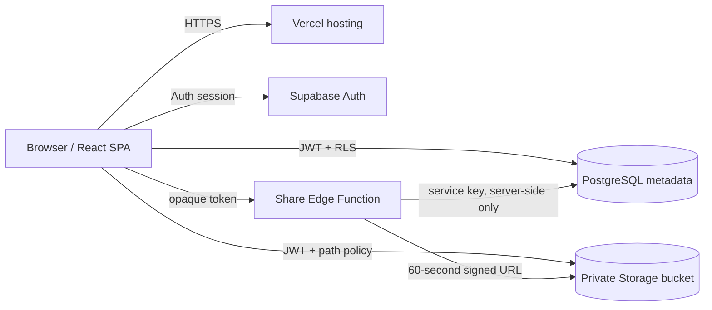
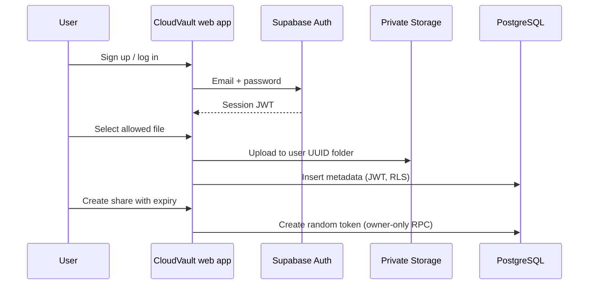

# CloudVault project report

## Abstract

CloudVault is a cloud-based file storage and sharing application. It combines a responsive React interface with Supabase authentication, PostgreSQL metadata, private object storage, and an Edge Function that grants temporary downloads through revocable links. The project demonstrates remote access, managed services, data persistence, access control, and cloud object storage in a small deployable system.

## Problem statement

Personal files are often scattered across devices, while basic sharing methods can expose files too broadly. This project provides a single internet-accessible place to store files and share selected objects under an expiry and revocation policy.

## Objectives

- Authenticate users using managed email/password authentication.
- Upload actual files to persistent cloud object storage.
- Isolate metadata and objects by user.
- Support search, sorting, download, and deletion.
- Share one file via high-entropy, revocable, optionally expiring links.
- Document deployment and security decisions for academic evaluation.

## Existing and proposed systems

**Existing system:** Local folders and ad-hoc attachments may not synchronize across devices and can create duplicate or overexposed copies.

**Proposed system:** A hosted single-page application uses a managed identity provider and cloud database/storage. Owner-scoped policies guard files, and a narrow server-side endpoint resolves anonymous share tokens.

## Requirements

### Hardware

- User device with a current browser, internet access, and a file to upload.
- Development machine with Node.js 20.19+ or 22.12+, pnpm, and Git.
- Cloud-hosted Supabase and Vercel accounts for deployment.

### Software

- React 19, TypeScript, Vite, Tailwind CSS, Lucide icons.
- Supabase Auth, PostgreSQL, Storage, Edge Functions.
- Vercel static hosting; Git/GitHub for source control.

## Architecture

### Data flow

1. A user signs in; Supabase returns a session token.
2. The browser uploads bytes to an owner-scoped path in a private bucket.
3. The browser writes file metadata with the same authenticated session; RLS verifies ownership and path.
4. For downloads, the session requests a short-lived signed URL. A share visitor instead sends one random token to the Edge Function.
5. The Edge Function checks expiry/revocation and signs only that object's path.

### Main workflow

## Database schema

| Table | Important fields | Access |
|---|---|---|
| `files` | id, owner_id, original_name, storage_path, mime_type, size_bytes, created_at | authenticated owner reads/inserts/deletes their rows |
| `file_shares` | id, file_id, owner_id, token, expires_at, revoked_at, created_at | owner reads; security-definer RPC creates/revokes |
| `activity` | id, owner_id, file_id, action, details, created_at | owner reads/inserts their records |

Auth identity is kept in Supabase `auth.users`; no password column exists in the app schema. `file_shares.file_id` cascades on file deletion. The storage bucket is private and paths begin with the owner UUID.

## Cloud service selection

- **Supabase Auth** provides managed identity/session handling.
- **Supabase PostgreSQL** stores file metadata and share state; RLS rules bind access to the authenticated UUID.
- **Supabase Storage** stores real bytes in a private bucket and evaluates object policies.
- **Supabase Edge Functions** keeps the privileged share lookup and service key server-side.
- **Vercel** serves the static Vite frontend and SPA routes.
- **GitHub** is the expected source repository and Vercel integration path.

The current Supabase pricing page lists a free plan with 1 GB file storage, 500 MB database size, 50,000 monthly active users, and 5 GB egress, and says free projects may pause after one week of inactivity. Quotas and terms may change; verify current pricing before deployment. Vercel's current Hobby terms limit that plan to personal or non-commercial use. This design does not depend on an assumed permanent free tier.

## Security and access control

See [SECURITY.md](../SECURITY.md). The essential controls are private-by-default storage, owner folder policies, row level security, high-entropy share tokens, server-side expiry/revocation checks, and short signed URL lifetimes.

## Testing and results

Verified locally on 2026-10-25: TypeScript project check passed; ESLint passed; Vitest passed 4 utility and upload-validation tests; Vite production build passed with split bundles; the built preview returned HTTP 200 for `/`, `/about`, `/app`, `/robots.txt`, `/sitemap.xml`, and `/favicon.svg`. These checks do not prove cloud integration. The Supabase project is healthy in Mumbai, and its schema/storage migration was applied successfully in SQL Editor. On 2026-10-26, Vercel production deployment became Ready at `https://cloud-vault-vert.vercel.app`; the Supabase client URL, publishable key, and canonical site URL were configured in Vercel and a production redeploy completed successfully. The landing page and signup form were opened, and the live sitemap and robots.txt were verified. Supabase Auth Site URL and production redirect allowlist were updated. Account creation, email confirmation, database persistence through the app, storage upload/download isolation, share expiry/revocation, and cross-user access have not yet been tested. The `public-share-download` Edge Function has not yet been deployed, so public share downloads are not complete.

## Deployment procedure

See [DEPLOYMENT.md](../DEPLOYMENT.md) for Supabase migration, Edge Function, Vercel environment variables, Auth redirects, manual verification, and Google Search Console steps.

## Advantages and limitations

**Advantages:** managed services; persistent remote object storage; user-scoped policies; no custom password handling; small deployment surface; responsive layout.

**Limitations:** 25 MB per file; only the listed MIME types; no malware scanning, version history, shared folders, or large-file resumable upload; share links are bearer credentials; free-tier quotas/inactivity can interrupt service; no configured monitoring alerts, backups, high availability, or disaster recovery. Actual deployed behavior depends on completing provider setup.

## Future scope

Add resumable large uploads, preview/transcoding, MFA, quota enforcement per user, richer audit events, malware scanning, formal backup/restore, alerts, and accessibility/user testing.

## Conclusion

CloudVault presents a concrete cloud file workflow built around identity, database RLS, object storage, server-side share validation, and static hosting. The frontend is publicly deployed and configured to connect to the owner's Supabase project. Full cloud operation still depends on deploying the share Edge Function and performing account-isolation and storage workflow tests.

## References

- [Supabase documentation](https://supabase.com/docs)
- [Supabase Storage access control](https://supabase.com/docs/guides/storage/security/access-control)
- [Supabase Edge Functions](https://supabase.com/docs/guides/functions)
- [Supabase pricing](https://supabase.com/pricing)
- [Vite documentation](https://vite.dev/guide/)
- [Vercel Vite deployment](https://vercel.com/docs/frameworks/frontend/vite)
- [Google Search Console](https://search.google.com/search-console/about)
